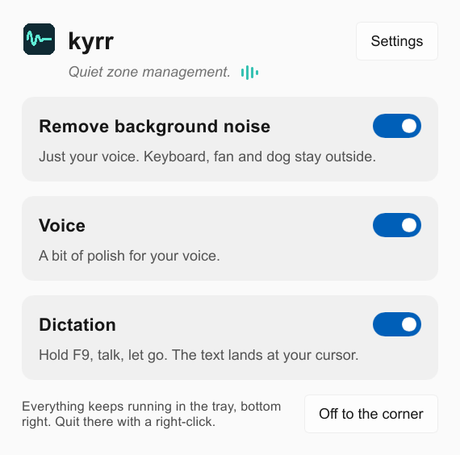
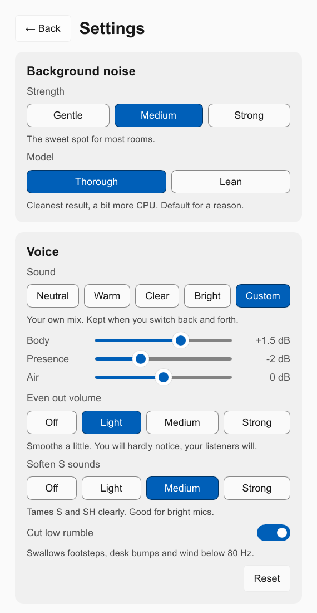

# kyrr

*kyrr* (Old Norse): still, quiet, at rest.

<p>
  <a href="https://github.com/heast13/kyrr/releases/latest/download/kyrr-setup.exe"></a>
  <a href="#install-on-linux"></a>
</p>

Website: [heast13.github.io/kyrr](https://heast13.github.io/kyrr/) (Deutsch: [/de/](https://heast13.github.io/kyrr/de/))

[](https://slint.dev)

A small, free app for your microphone, for **Windows** and **Linux**:
cleaner sound, a better voice and dictation, all on your own computer.

> **Everything runs on your PC.** Your voice and your dictated text never
> leave your computer: no cloud, no account, no telemetry. Once the speech
> model is downloaded, kyrr works fully offline. [Details](#privacy)

What it does:

- **Isolate your voice.** Real-time neural noise suppression
  ([DPDFNet](https://github.com/ceva-ip/DPDFNet)) on your microphone, for
  every app: Teams, Zoom, Discord, OBS, the browser. A large model for the
  cleanest result, a small one for older laptops.
- **Improve voice.** Shaping after the noise is gone: a sound (Neutral, Warm,
  Clear, Bright or your own), a compressor, softer S sounds, pop protection
  and a cut for low rumble.
- **Automatic volume.** Brings your voice to the same level however loud
  your microphone is set.
- **Dictation.** Hold F9 (or a key of your own; or tap to start and
  stop), speak, release. The text appears where your cursor is. German,
  English and more European languages (French, Spanish, Italian, Dutch,
  Polish, Portuguese and others), transcribed on your PC. Say "new line" or
  "neue Zeile" for a line break. While you dictate, a small wave at the
  bottom of the screen shows that kyrr is listening, with the words heard so
  far (switch "Live text" off in Setup), and then that it is writing.
- **Voice memos.** Tap F8, talk, tap F8 again: kyrr saves the recording
  as a small audio file in Documents/kyrr and names it after its first
  words. Play, rename, show in the folder or delete them in the list; one
  click writes the whole text of a memo, with the minute each part starts,
  on your PC. Can be switched off on the main page.
- **Check.** A live level of what the microphone hears and what apps get,
  a ten-second test (record once, then play the take before and after kyrr)
  and listening to yourself live on headphones.
- **Follows your microphone.** Plug in another one, or the same one into
  another USB port, and kyrr moves along by itself. It also tells you what
  is wrong: a muted microphone (with a button to switch it back on), none
  found, or one that just arrived.

<p align="center">
  
</p>
<p align="center">
  
</p>

Status: young and in active development.

## Compared with

| | kyrr | NVIDIA Broadcast | Krisp |
|---|---|---|---|
| Price | free, open source | free | free for 60 minutes a day, subscription beyond |
| Needs | any 64-bit Intel or AMD PC with Windows 10 or 11, or Linux with PipeWire | an NVIDIA RTX graphics card | an account |
| Where it works | on the microphone itself: every app, nothing to choose | apps set to its virtual microphone | apps set to its virtual microphone |

On top, kyrr dictates into any app, on your computer. As far as we know in
October 2026; corrections welcome.

## Install

### Windows

Windows 10 22H2 or Windows 11, 64-bit.

1. Download `kyrr-setup-<version>.exe` from the [latest
   release](https://github.com/heast13/kyrr/releases/latest) (see the [code
   signing policy](#code-signing-policy)).
2. Run it. The installer needs administrator rights, and sound drops out for
   a second while kyrr sets up its filter.
3. Until the installer is code-signed, Windows SmartScreen warns about it
   ("More info", "Run anyway"); compare the installer with its `.sha256`
   file from the release page first.

On Windows on ARM (Snapdragon and other ARM processors) kyrr only dictates:
its noise filter is built for Intel and AMD processors, and the audio engine
there cannot load it.

<details>
<summary>Uninstall</summary>

Uninstalling takes the filter off the microphone, puts the Windows setting
described under "How it works" back and asks whether to delete the downloaded
speech models.

</details>

<a id="install-on-linux"></a>

### Linux (beta, AppImage)

The Linux version works, but has been tested on fewer systems than the
Windows version. One file, an AppImage, for every distribution.

**With a terminal.** Paste this; it downloads kyrr, makes it executable and
starts it:

```sh
mkdir -p ~/.local/bin
curl -fL -o ~/.local/bin/kyrr.new https://github.com/heast13/kyrr/releases/latest/download/kyrr-x86_64.AppImage && chmod +x ~/.local/bin/kyrr.new && mv -f ~/.local/bin/kyrr.new ~/.local/bin/kyrr
~/.local/bin/kyrr --replace &
```

**Prefer clicking?**

1. Download `kyrr-x86_64.AppImage` from the [latest
   release](https://github.com/heast13/kyrr/releases/latest).
2. Allow executing it as a program in your file manager (right click,
   Properties).
3. Double click it.

Either way kyrr adds itself to your app menu on its first start.

**Start at sign-in** switches on by itself when the first-start setup is
done. Switch it off or on again in Setup, "Start when you sign in".

**Updates** are not installed by themselves: kyrr says when there is a new
version; paste the install commands again: a running kyrr closes, the file is
replaced and the new version starts.

**Requirements**

- 64-bit Intel or AMD with glibc 2.39 or newer (Ubuntu 24.04, Fedora 40,
  Debian 13, Linux Mint 22, Arch or newer).
- PipeWire for the noise filter, which these use anyway; where it is
  missing, a button in kyrr installs it (your system asks for your password).
- A processor with AVX2 for the noise filter (most from 2015 on); dictation
  works without.
- FUSE 3 (the `fuse3` package), which AppImages need to start. Every
  desktop system has it; a bare server image may not.
- No administrator rights needed.

**Desktop notes**

- GNOME 48+ and KDE: your desktop asks once for the dictation and voice
  memo keys and once whether kyrr may type; kyrr walks you through both.
- GNOME 46 and 47: kyrr adds the keys to GNOME's own keyboard shortcuts,
  where each press starts or ends dictation (or a voice memo).
- Hyprland (Omarchy, say), Sway, river and niri: kyrr adds the key to your
  key bindings itself, in a block of its own that it keeps up to date, and
  the start at sign-in too where the session does not start XDG autostart
  entries.
- X11 desktops (Linux Mint, XFCE): the key just works.
- Without a tray icon the window's X minimizes kyrr where the desktop can
  bring it back (GNOME, say) and quits it on tiling ones; "Quit" always ends
  it.

<details>
<summary>Uninstall</summary>

Quit kyrr ("Quit" at the bottom left), then:

```sh
rm -f ~/.local/bin/kyrr \
  ~/.config/autostart/io.github.heast13.kyrr.desktop \
  ~/.local/share/applications/io.github.heast13.kyrr.desktop \
  ~/.local/share/icons/hicolor/256x256/apps/io.github.heast13.kyrr.png \
  ~/.local/share/icons/hicolor/scalable/apps/io.github.heast13.kyrr.svg
rm -rf ~/.config/kyrr ~/.local/share/kyrr
```

The last line also deletes your settings and the downloaded speech models;
leave it out to keep them. Used a different place for the file? Delete that
instead of `~/.local/bin/kyrr`.

On Hyprland, Sway, river and niri, delete the blocks between the `>>> kyrr`
and `<<< kyrr` lines (keys and start at sign-in) from your config; on GNOME,
delete the "kyrr" and "kyrr: voice memo" entries under Custom Shortcuts in
the keyboard settings. Your voice memos stay in Documents/kyrr.

</details>

## How it works

**Isolate your voice.** kyrr installs an audio processing object (APO), a
filter the Windows audio engine runs on the microphone itself, the way
Equalizer APO does. Every app gets the cleaned signal without choosing a
virtual device. If the microphone's driver has its own effect (for example
beamforming), kyrr keeps it and runs after it. Latency is 60 ms at 48 kHz.
On processors without AVX2 the filter falls back to ONNX Runtime and kyrr
switches to the small model once.

Windows only loads audio filters signed by Microsoft unless the setting
`DisableProtectedAudioDG` is on. kyrr's installer switches it on, as
Equalizer APO's does, says so before it starts, and restores the previous
value on uninstall (unless Equalizer APO is installed and still needs it).
If a Windows or driver update takes kyrr off the microphone, the app notices
and offers to repair it.

On Linux kyrr does the same as a PipeWire microphone of its own, called
"kyrr": it reads your real microphone, removes the noise and becomes the
system's default microphone, so every app that uses the default gets the
cleaned signal. kyrr only reads your real microphone while an app listens to
"kyrr". When kyrr quits, its microphone goes away and the system falls back
to your real one.

**Improve voice.** The same filter can shape the voice: a low cut (80 Hz,
100 Hz for the bright sound) before the noise filter, then three EQ bands
(body at 250 Hz, presence at 3 kHz, air above 8 kHz), a de-esser on the band
above 4 kHz, a compressor (light, medium or strong) and a limiter at
−1 dBFS. It works with the noise filter switched off too, and adds no
latency. On by default with a neutral sound, medium compression, light
S-sound softening and the low cut; pop protection is off by default. Reset
brings back the defaults.

*Pop protection* listens to the raw microphone for the thump of a P or B and
turns everything below 120 Hz down while it lasts, starting 10 ms before the
thump arrives. *Automatic volume* (on by default, works with the voice
shaping switched off too) measures the voice only while someone speaks and
moves it slowly (5 dB/s up, 10 dB/s down, at most +24/−12 dB) towards about
−23 dBFS; pauses, clicks and steady noise leave it alone. Apps that
adjust the volume themselves (call apps, say) can work against it, so use
one of the two.

*Distance compensation* (on by default, switch it off under the voice gear)
helps when you sit far from the microphone and the room echoes on every word. It listens to the raw
microphone: after a syllable a close voice falls 20 dB and more within
40 ms, while far away no level falls faster than the room's echo dies down.
After 5 to 15 seconds of speech that tells near from far. Only when far, it
fades in over two seconds: the echo tail after each syllable goes down by up
to 8 dB in four bands, a little bass comes back (+2.5 dB below 150 Hz),
some box goes (−2.5 dB at 450 Hz) and a touch of presence is added (+1.5 dB
at 3.5 kHz), all before the automatic volume. Close to the microphone the
audio stays the same bit for bit. While it is on and the microphone sounds
far, the main page also suggests moving a little closer.

**Your microphone.** kyrr checks every few seconds which microphone the system
uses. When it changes, the filter moves along: Windows asks for permission
once and sound pauses for a moment; on Linux it simply moves. If that does not
happen (you declined, say), a button on the main page offers it. A microphone
you pick by hand stays until the system's default changes.

**Check.** On Windows the filter shares a small block of memory with the app
(`Global\kyrr-monitor-3`): the level before and after kyrr, what the
automatic volume adds, whether the microphone sounds far, and on request one ten-second take, unprocessed and
processed. The audio service writes it; users signed in at this computer can
read it and ask for a take, which only records while an app already uses the
microphone. The app plays the take, keeps it only in memory and clears it
from the shared block.

On Linux the filter runs inside the app, which reads the levels and the
take directly.

**Dictation.** kyrr records while the key is held (up to 15 minutes) and
transcribes locally with [sherpa-onnx](https://github.com/k2-fsa/sherpa-onnx) (its build without
text-to-speech). The speech model is downloaded once on first use and let go
of after a quarter of an hour without dictation:

| Language | Model | Size |
|---|---|---|
| German | [primeline/parakeet-primeline](https://huggingface.co/primeline/parakeet-primeline), a German fine-tune of NVIDIA Parakeet; also handles English | 900 MB |
| English | [NVIDIA parakeet-unified-en-0.6b](https://huggingface.co/nvidia/parakeet-unified-en-0.6b) | 663 MB |
| Multilingual (Language choice in the first-start setup and in Setup) | [NVIDIA parakeet-tdt-0.6b-v3](https://huggingface.co/nvidia/parakeet-tdt-0.6b-v3), 25 European languages, picks the language itself. Works in French, Spanish, Polish, Portuguese, Italian and Dutch (see the measurements in `tools/export-primeline`); German and English also work | 900 MB |

On Windows dictation does nothing while a window running as administrator is
in front: Windows keeps normal programs from seeing the keyboard there.

**Voice memos.** The memo key (F8, or a key of your own; tap it to start and
again to end, or hold it, as you like) starts and ends a recording, as does the
tray menu. kyrr records the
microphone as dictation hears it (with the noise filter when it is on) as Opus (mono,
24 kbit/s, about 11 MB an hour) for up to four hours, into `Documents/kyrr`
(the folder Windows or your desktop calls Documents, wherever it is). The
file is called `2026-10-21 14-05 Title.opus`: when the recording ends, the
dictation model listens to its first seconds and the first real sentence
becomes the title. "Write text" transcribes the whole memo in pieces of
half a minute, cut at a pause, and saves the text beside it as
`… Title.txt`, one paragraph per piece with its start time (`[1:30] …`).
Clicking a time plays the memo from there. Dictation comes first: while you
dictate, the text waits. The memo key does nothing while you dictate, and
the dictation key nothing while a memo records.

On Linux the memo key is set up like the dictation key: GNOME 48 and KDE
ask for both keys in one dialog, GNOME 46 and 47 get a second custom
shortcut, and on Hyprland, sway, river and niri the key goes into kyrr's
block in the config.

**Keys.** Dictation (F9) and voice memos (F8) each have a field "Set key" next
to the standard key: click in, press a key, done. One key each, never the
same for both. Offered are F1 to F24, Pause, Scroll Lock, the menu key and
right Ctrl; keys programs need for typing (letters, Space, Enter, arrows,
Shift, Alt, left Ctrl, Windows) are turned down. kyrr takes the key from
every program while it runs, except with Ctrl, Alt, Shift or Windows held;
that is why F5, F11 and the like come with a warning, and why right Ctrl
costs the shortcuts that use it. Where the desktop owns the key (GNOME 48
and KDE) the field is replaced by a button to the desktop's own shortcut
settings. Holding works wherever the desktop reports the release: not on
GNOME 46 and 47 (a custom shortcut only reports the press) and not on niri,
where each press toggles instead.

## Privacy

Audio and text never leave your computer. No telemetry. kyrr connects to
the internet for exactly these things:

- **The speech model**, once, when you first use dictation: from kyrr's own
  mirrors ([Hugging Face](https://huggingface.co/heast13/kyrr-models), else
  [GitHub](https://github.com/heast13/kyrr-assets); the English model last
  from the sherpa-onnx project's Hugging Face page), every file checked
  against a SHA256 hash built into kyrr.
- **The update check**: once a day, one request to the GitHub API for the
  newest version number of kyrr (`api.github.com/repos/heast13/kyrr/releases/latest`),
  whose answer also carries the short "What's new" text of that version.
  It sends nothing about you beyond what any web request carries: your IP
  address and "kyrr/<version>" as the program's name. It can be switched
  off under Setup ("Check for updates automatically"); then
  kyrr only asks when you click "Check for updates".
- **An update**, only when you click "Update": the installer of the new
  version from this repository's releases, checked against its SHA256 file.
  Where kyrr cannot install it itself (Linux, or a failed download), it
  opens the download page on the website instead.

Voice memos and their texts stay in your Documents folder; kyrr sends
none of them anywhere. Record other people only when they agree to it.

Nothing is installed without your click. (Building kyrr also downloads its
assets and libraries, from kyrr's mirror on GitHub first.)

## Code signing policy

kyrr's releases are not code-signed. A free certificate from the SignPath
Foundation was applied for and declined for now, because kyrr is not known
widely enough yet. That is why Windows SmartScreen warns about the installer
("More info", "Run anyway").

To check that a download is the one built from this repository, compare it
with the `.sha256` file on the release page. Every release is built on
GitHub by the [release workflow](.github/workflows/release.yml) from a
version tag of this repository. Third-party files keep the signatures of
their authors (ONNX Runtime and the Visual C++ runtime by Microsoft); models
are data.

kyrr sends no data about you or your computer anywhere, see
[Privacy](#privacy).

## Building

On Windows, with Rust (MSVC), the Visual Studio Build Tools and Python 3; for
the installer Inno Setup 6.

```powershell
python scripts/fetch-assets.py --windows
$env:SHERPA_ONNX_LIB_DIR = "$PWD\assets\sherpa-onnx\lib"
cargo build --release -p kyrr -p kyrr-apo
python scripts/package.py
```

`SHERPA_ONNX_LIB_DIR` points the build at sherpa-onnx's libraries without
text-to-speech; the default ones bundle espeak-ng (GPL-3.0).
`scripts/check-binaries.py` (run by `package.py` and CI) refuses a build
that contains it, or a filter DLL that needs the Visual C++ runtime.

On Linux (the packages libpipewire-0.3-dev, libclang-dev, libasound2-dev,
libfontconfig1-dev, libxkbcommon-dev, libxkbcommon-x11-0 and libssl-dev, or
their names elsewhere):

```sh
python3 scripts/fetch-assets.py --linux
SHERPA_ONNX_LIB_DIR=$PWD/assets/sherpa-onnx/lib cargo build --release -p kyrr
python3 scripts/package-linux.py   # dist/: AppImage and tarball, each with a .sha256
```

`package-linux.py` downloads linuxdeploy and appimagetool (pinned by SHA256)
and needs `libxkbcommon-x11` installed to bundle it. The AppImage runs on the
glibc of the machine that built it or newer (the release is built on
Ubuntu 24.04: glibc 2.39).

The cores (`kyrr-denoise`, `kyrr-voice`, `kyrr-dictate`) build and test on Linux too;
`cargo run -p kyrr --example preview -- <dir>` renders the window headless.

## Feedback

In kyrr, Setup, About, "Feedback" opens an e-mail to
stueckig.habicht_2o@icloud.com with the kyrr version and your system filled
in. kyrr sends nothing by itself. Issues on GitHub work too.

## License

kyrr is licensed under either of

- Apache License, Version 2.0 ([LICENSE-APACHE](LICENSE-APACHE))
- MIT license ([LICENSE-MIT](LICENSE-MIT))

at your option. Third-party components and models keep their own licenses,
see [THIRD_PARTY.md](THIRD_PARTY.md); the app shows the model credits under
Setup, About. kyrr's window is made with [Slint](https://slint.dev) under
its royalty-free license, which asks for the badge at the top of this page.
Security issues: see [SECURITY.md](SECURITY.md).

If you build on kyrr, please keep the copyright notice and
[NOTICE](NOTICE) (the licenses ask for it) and, if you like, mention
heast13 with a link to this repository.

## Thanks

kyrr stands on the work of others. Thank you to

- [Fovty](https://github.com/Fovty) for HushMic, whose DPDFNet runtime
  kyrr's filter is built on,
- [Ceva](https://github.com/ceva-ip/DPDFNet) for DPDFNet and for releasing
  its models openly,
- [primeLine AI](https://huggingface.co/primeline/parakeet-primeline) for
  the German speech model,
- NVIDIA for Parakeet, the model family behind all dictation languages,
- csukuangfj and the [k2-fsa](https://github.com/k2-fsa/sherpa-onnx) team
  for sherpa-onnx and the English model in ONNX,
- [Equalizer APO](https://sourceforge.net/projects/equalizerapo/), which
  showed how a filter can live inside Windows audio,
- [Slint](https://slint.dev) for the UI toolkit.
